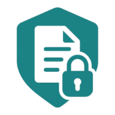
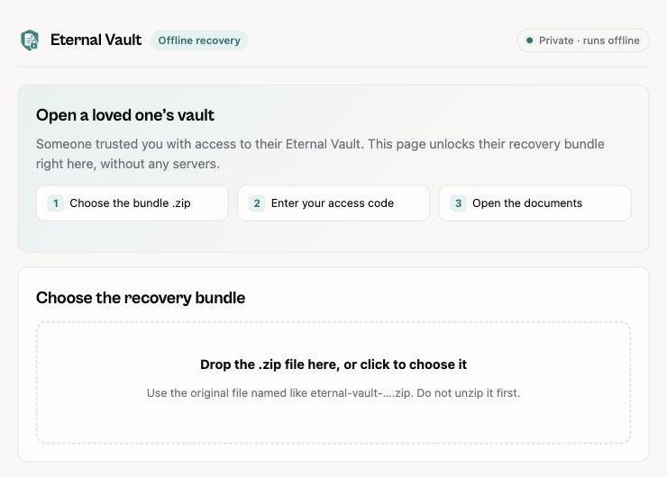
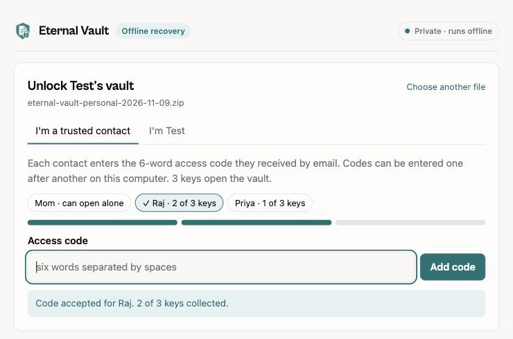
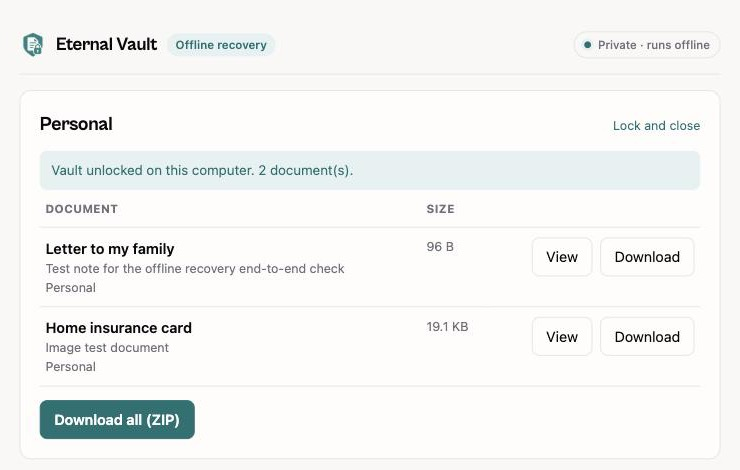

<p align="center">
  
</p>

<h1 align="center">Eternal Vault Recovery</h1>

<p align="center">
  Open an Eternal Vault recovery bundle on your own computer. No account, no internet needed.
</p>

<p align="center">
  <a href="https://github.com/AkashRajpurohit/eternal-vault-recovery/releases/latest"><b>Download recover.html</b></a>
  &nbsp;·&nbsp;
  <a href="https://eternalvault.app/continuity">What is this?</a>
</p>

---

## Open a vault

You need the **recovery bundle** (a `.zip` file) and your **6-word access code**.

1. Download [`recover.html`](https://github.com/AkashRajpurohit/eternal-vault-recovery/releases/latest). It's also inside the bundle's `.zip`.
2. Open it in your browser by double-clicking it.
3. Choose the bundle `.zip`. Don't unzip it.
4. Enter your access code. If others are needed, they enter theirs on the same computer.

That's it. The documents open on your computer and nothing is sent anywhere.

<p align="center">
  
  
  
</p>

> [!IMPORTANT]
> Only type your access code into `recover.html`. Never into a website that asks for it.

## Check the file is genuine

Compare its fingerprint with `SHA256SUMS` on the [release page](https://github.com/AkashRajpurohit/eternal-vault-recovery/releases/latest):

```sh
shasum -a 256 recover.html                      # macOS / Linux
Get-FileHash recover.html -Algorithm SHA256     # Windows PowerShell
```

## For developers

```sh
pnpm install
pnpm test          # includes bundles every version must keep opening
pnpm build:tool    # builds dist-tool/recover.html
```

- [`FORMAT.md`](FORMAT.md) describes the bundle format byte for byte.
- [`SECURITY.md`](SECURITY.md) covers the security model and how to report a problem.

## License

[MIT](LICENSE). Anyone may host, mirror or rebuild this tool.
